# CMOS Full Adder Design Using Reusable Logic Cells

> **Mini Project Report**  
> **Design level:** Transistor-level CMOS building blocks with schematic-level hierarchical integration  
> **Design environment:** Cadence Virtuoso (schematic capture and waveform-based simulation)  
> **Main function:** 1-bit binary addition of inputs `A`, `B`, and `C` (carry-in)

---

## 1. Abstract

This project presents the schematic design and functional verification of a 1-bit CMOS full adder. The design is assembled hierarchically from reusable logic cells: a CMOS inverter, a 2-input NAND gate, a 2-input XOR gate, and a 2:1 multiplexer (MUX). Individual cells are represented by schematics and symbols, and their behavior is checked using testbench simulations. The verified cells are then interconnected to form the complete full-adder circuit.

The full adder accepts three one-bit inputs—`A`, `B`, and `C` (carry-in)—and generates two outputs: `SUM` and `CARRY` (carry-out). The sum is produced using two cascaded XOR operations. The carry-out is generated using a 2:1 MUX controlled by the intermediate XOR signal. The supplied schematic and waveform captures document the design hierarchy and the functional checks performed.

## 2. Project Objectives

- Design reusable CMOS logic building blocks at schematic level.
- Create symbols for the cells so they can be instantiated hierarchically.
- Implement and verify an inverter, NAND gate, XOR gate, and 2:1 MUX.
- Integrate the verified blocks into a 1-bit full-adder architecture.
- Apply input combinations through testbenches and inspect output waveforms.
- Confirm that the observed `SUM` and `CARRY` outputs agree with the full-adder truth table.

## 3. Design Overview

### 3.1 Full-adder inputs and outputs

| Signal | Direction | Description |
|---|---|---|
| `A` | Input | First operand bit |
| `B` | Input | Second operand bit |
| `C` | Input | Carry-in bit |
| `SUM` | Output | Least-significant result bit |
| `CARRY` | Output | Carry-out bit |

### 3.2 Boolean equations

The intermediate propagate/XOR term is:

$$
P = A \oplus B
$$

The sum output is:

$$
\boxed{SUM = A \oplus B \oplus C = P \oplus C}
$$

The carry-out equation is:

$$
\boxed{CARRY = AB + PC = AB + C(A \oplus B)}
$$

The carry equation can also be implemented with a 2:1 MUX:

$$
CARRY = \operatorname{MUX}(A,C,P)
$$

For the MUX convention used in the top-level schematic, `A` is selected when `P=0`, and `C` is selected when `P=1`. This is equivalent to the Boolean carry equation because:
- If `P=0`, then `A=B`, so the carry-out equals `A` (and also `B`).
- If `P=1`, then `A` and `B` differ, so the carry-out equals the carry-in `C`.

### 3.3 Block-level architecture

```text
                 ┌─────────┐       ┌─────────┐
       A ───────►│         │       │         │──────► SUM
                 │  XOR    ├── P ─►│  XOR    │
       B ───────►│         │       │         │
                 └─────────┘       └────▲────┘
                                        │
                                        C

       A ───────────────────────┐
                                │  Data input 0
                             ┌──┴───────┐
       C ───────────────────►│  2:1 MUX ├──────► CARRY
                             └────▲────┘
                                  │ Select
                                  P = A XOR B
```

The top-level implementation below shows the two XOR stages for `SUM` and the MUX-based carry path.

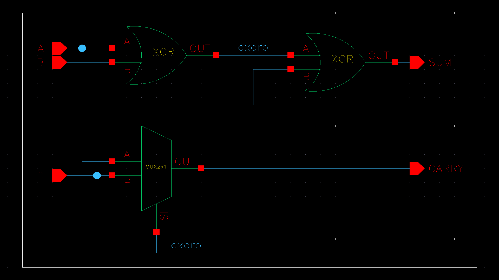

*Figure 1. Full-adder schematic showing the cascaded XOR path and MUX-based carry path.*

The full-adder symbol exposes the three inputs and two outputs for convenient reuse in a higher-level design.

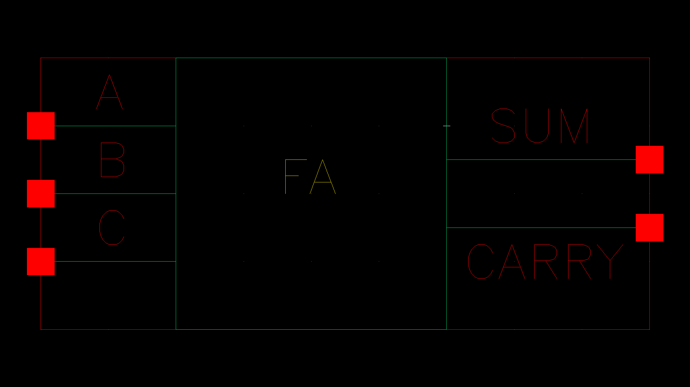

*Figure 2. Full-adder symbol.*

## 4. Building Blocks

### 4.1 CMOS inverter

The inverter produces the complement of its input:

$$
Y = \overline{A}
$$

A conventional CMOS inverter uses one PMOS pull-up transistor and one NMOS pull-down transistor. The PMOS is controlled by the input and connects the output toward the positive supply when the input is low. The NMOS connects the output toward ground when the input is high.

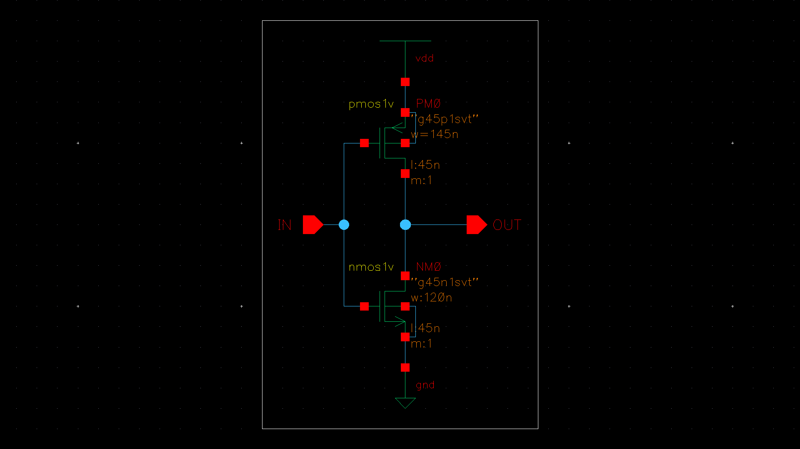

*Figure 3. CMOS inverter schematic.*

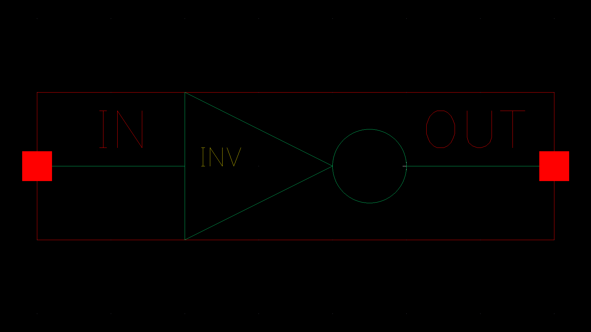

*Figure 4. Inverter symbol.*

**Functional check:** The output should be high for a low input and low for a high input.

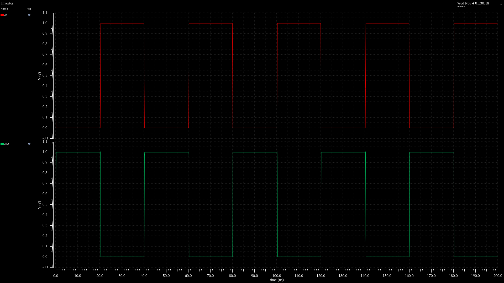

*Figure 5. Inverter input/output waveform.*

### 4.2 2-input NAND gate

The NAND gate implements:

$$
Y = \overline{AB}
$$

In static CMOS logic, the pull-down network has two NMOS transistors in series, while the pull-up network has two PMOS transistors in parallel. The output is pulled low only when both inputs are high; otherwise, it is pulled high.

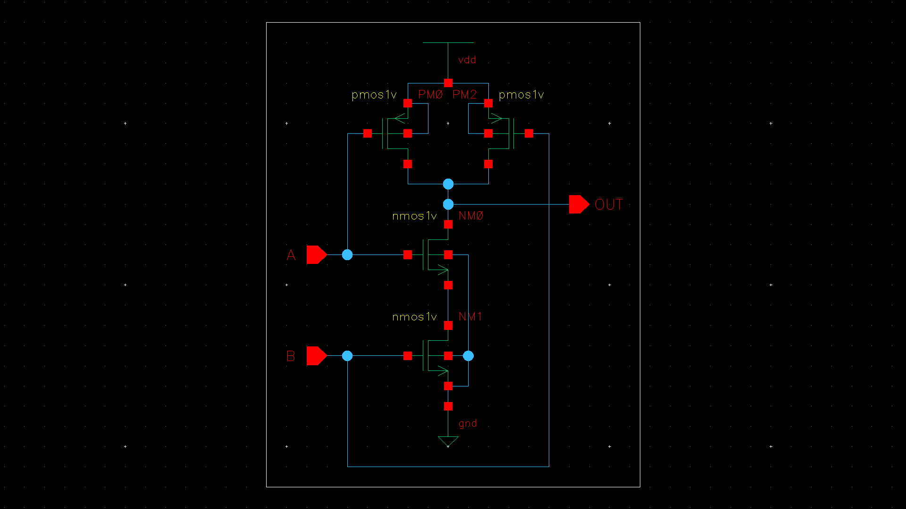

*Figure 6. 2-input NAND gate schematic.*

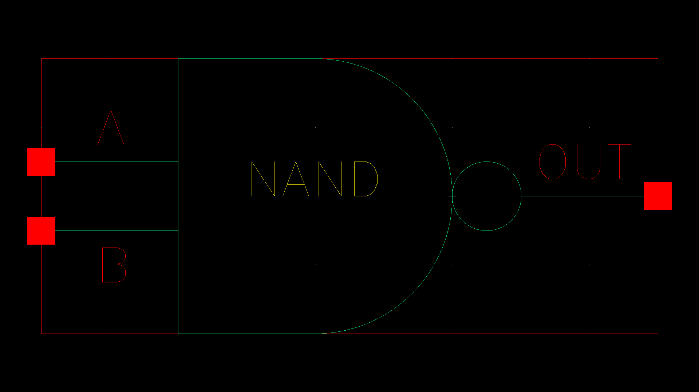

*Figure 7. NAND symbol.*

**Truth table**

| A | B | NAND output |
|---:|---:|---:|
| 0 | 0 | 1 |
| 0 | 1 | 1 |
| 1 | 0 | 1 |
| 1 | 1 | 0 |

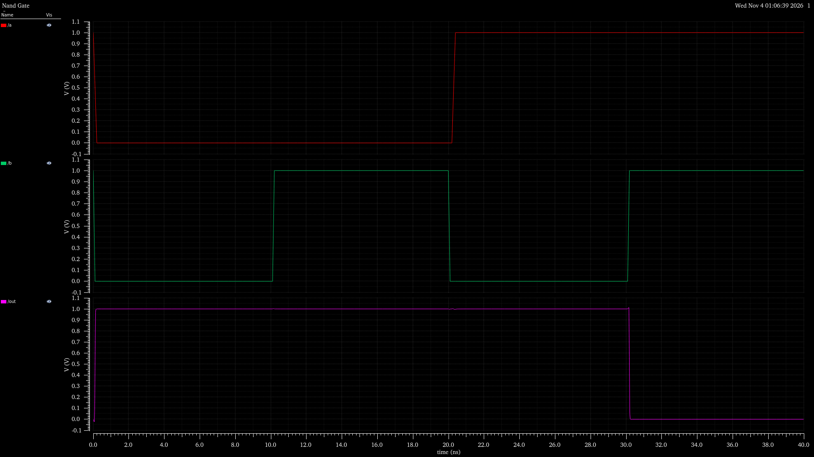

*Figure 8. NAND gate testbench waveform.*

### 4.3 2-input XOR gate

The XOR gate implements:

$$
Y = A \oplus B = \overline{A}B + A\overline{B}
$$

The supplied XOR schematic is built using four NAND-gate stages. A common NAND realization is:

$$
N_1 = \overline{AB}
$$

$$
N_2 = \overline{A N_1}
$$

$$
N_3 = \overline{B N_1}
$$

$$
Y = \overline{N_2N_3}
$$

This produces a logic high when the two inputs are different.

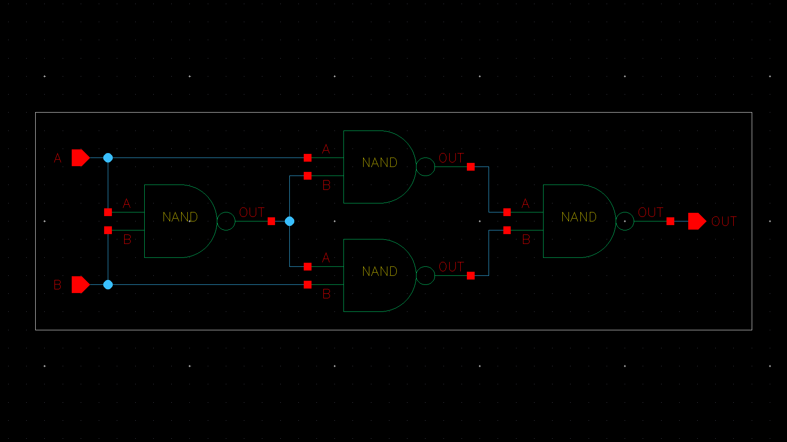

*Figure 9. XOR gate schematic using NAND-based logic.*

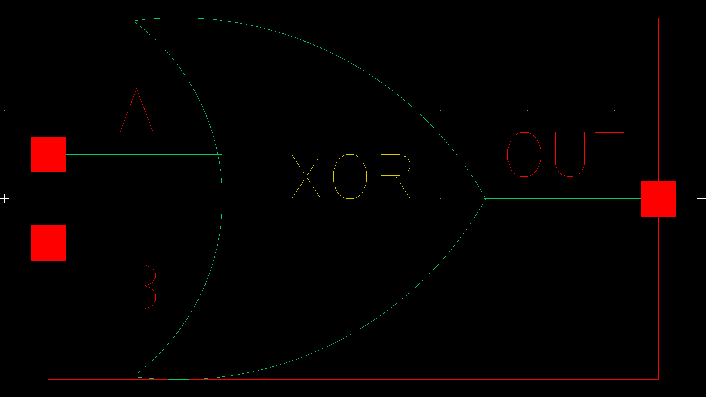

*Figure 10. XOR symbol.*

**Truth table**

| A | B | XOR output |
|---:|---:|---:|
| 0 | 0 | 0 |
| 0 | 1 | 1 |
| 1 | 0 | 1 |
| 1 | 1 | 0 |

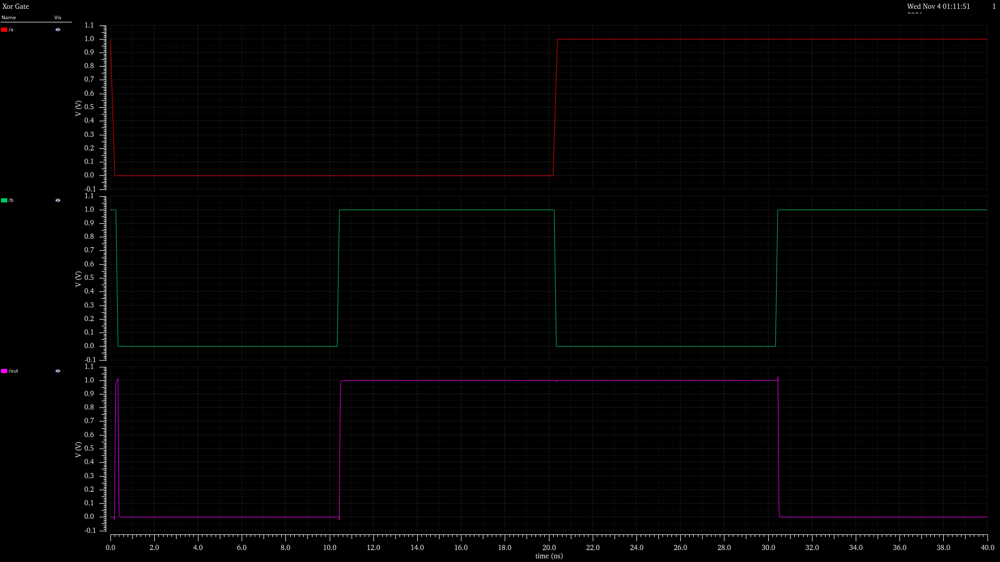

*Figure 11. XOR gate testbench waveform.*

### 4.4 2:1 multiplexer

A 2:1 MUX selects one of two data inputs based on a select signal. Its Boolean equation is:

$$
Y = \overline{SEL}\,A + SEL\,B
$$

The supplied transistor-level schematic uses complementary select controls and PMOS/NMOS transmission paths, with an inverter generating the complementary select signal.

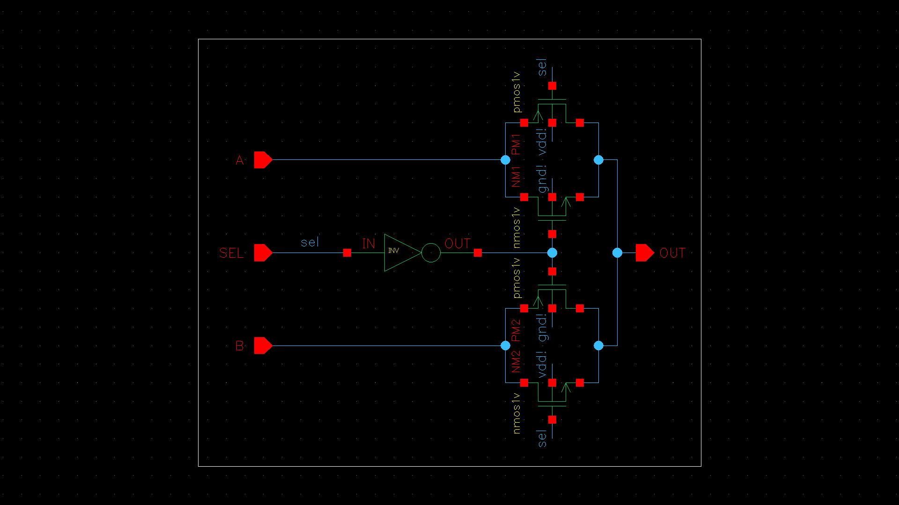

*Figure 12. 2:1 MUX transistor-level schematic.*

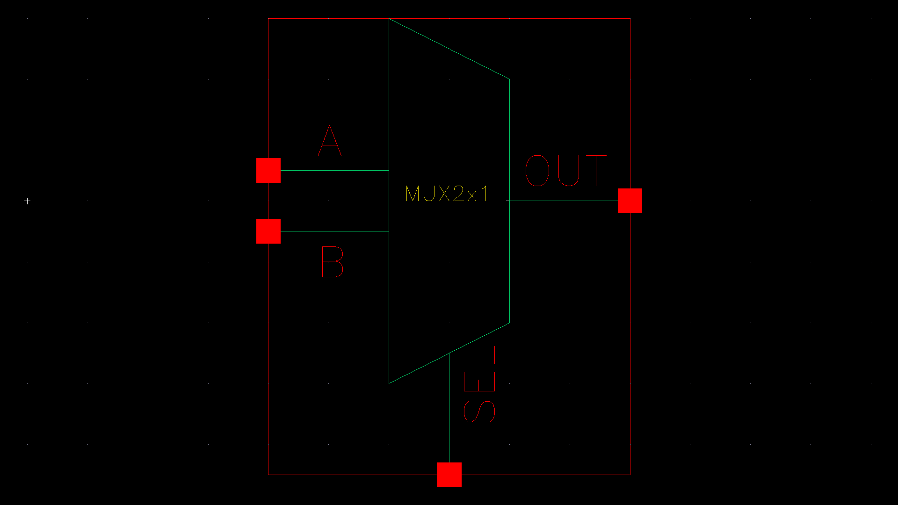

*Figure 13. 2:1 MUX symbol.*

**Functional table**

| SEL | Output |
|---:|---|
| 0 | A |
| 1 | B |

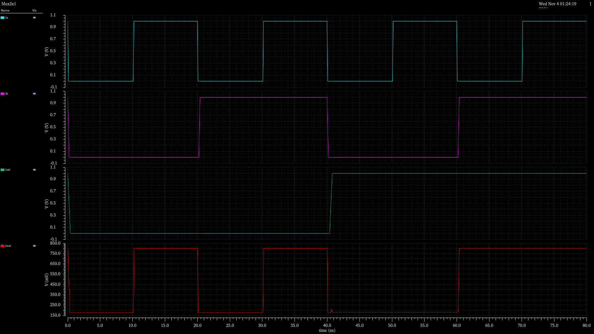

*Figure 14. 2:1 MUX testbench waveform.*

## 5. Full-Adder Operation

The circuit first computes the intermediate term:

$$
P = A \oplus B
$$

The first XOR output is connected to one input of the second XOR. The carry-in `C` is connected to the other input of the second XOR, producing:

$$
SUM = P \oplus C
$$

The same intermediate signal `P` drives the MUX select input. The MUX data inputs are `A` and `C`, so:

$$
CARRY = \overline{P}A + PC
$$

Since `P=0` means `A=B`, and `P=1` means `A\ne B`, this MUX expression is equivalent to:

$$
CARRY = AB + C(A \oplus B)
$$

### 5.1 Full-adder truth table

| A | B | C (carry-in) | SUM | CARRY (carry-out) |
|---:|---:|---:|---:|---:|
| 0 | 0 | 0 | 0 | 0 |
| 0 | 0 | 1 | 1 | 0 |
| 0 | 1 | 0 | 1 | 0 |
| 0 | 1 | 1 | 0 | 1 |
| 1 | 0 | 0 | 1 | 0 |
| 1 | 0 | 1 | 0 | 1 |
| 1 | 1 | 0 | 0 | 1 |
| 1 | 1 | 1 | 1 | 1 |

The truth table contains all $2^3 = 8$ possible input combinations. `SUM` is the odd-parity bit of the three inputs, while `CARRY` is high whenever at least two of the three inputs are high.

## 6. Testbench and Simulation

Each basic cell has a corresponding testbench waveform capture. The full-adder testbench schematic applies the input signals to the complete circuit, and the resulting waveform is used to inspect both outputs. **All output waveforms included in this project were obtained using transient analysis over a simulation interval extending to 80 ns (0–80 ns).**

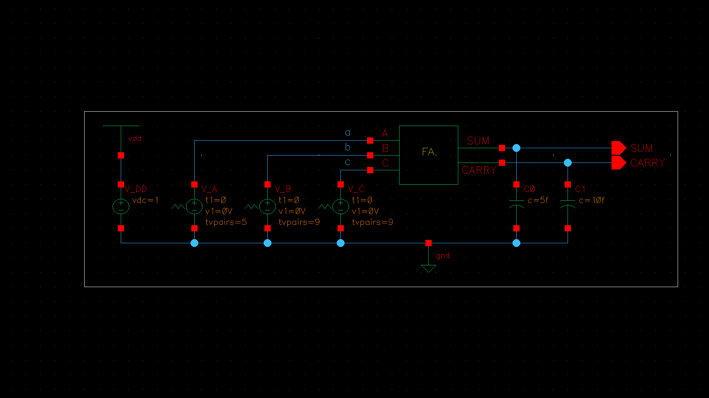

*Figure 15. Full-adder testbench schematic.*

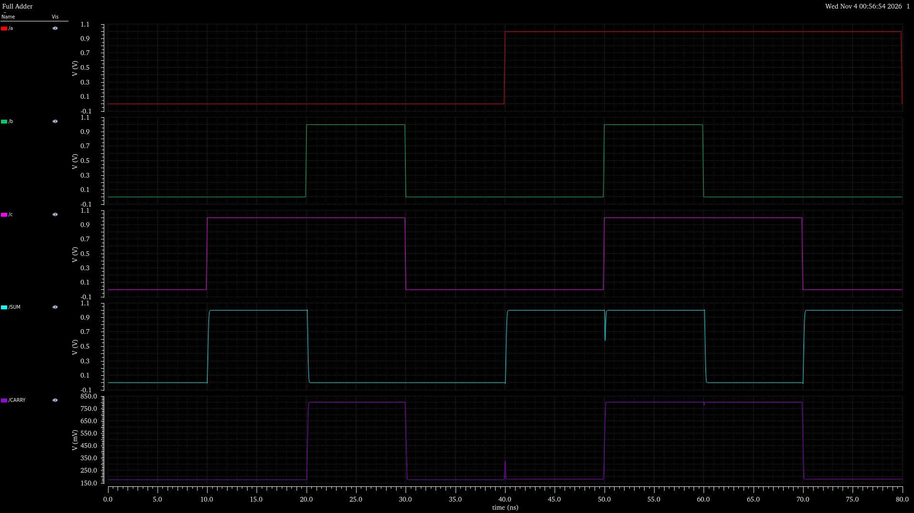

*Figure 16. Full-adder simulation waveform showing the input and output transitions.*

### 6.1 Verification procedure

1. Create the transistor-level schematic for each basic cell.
2. Check the schematic connections and supply connections.
3. Create a symbol for each cell.
4. Instantiate the symbols in the corresponding testbench.
5. Apply input patterns that exercise the cell's truth table.
6. Run transient analysis with the simulation stop time set to 80 ns, then inspect the input and output waveforms over the 0–80 ns interval.
7. Instantiate the verified XOR and MUX cells in the full-adder schematic.
8. Apply all eight combinations of `A`, `B`, and `C`.
9. Compare the observed `SUM` and `CARRY` values against the truth table in Section 5.1.

### 6.2 Expected verification results

| Circuit | Required behavior |
|---|---|
| Inverter | Output is the complement of the input |
| NAND | Output is low only for `A=B=1` |
| XOR | Output is high only when the inputs differ |
| 2:1 MUX | Output follows the data input selected by `SEL` |
| Full adder | `SUM` and `CARRY` match all eight truth-table rows |

**Reading the waveform captures:** The traces should be interpreted by matching each output level to the corresponding input combination at the same simulation time. All displayed output waveforms were captured from transient analysis up to 80 ns. The 80 ns value is the simulation observation window, not a measured propagation delay. Exact propagation delay, rise/fall time, power, and other numerical performance values are not reported because no measurement data or detailed stimulus timing settings were supplied.

## 7. Results and Discussion

The project demonstrates a hierarchical approach to CMOS digital design. Basic cells are designed and symbolized independently, which allows them to be reused in larger circuits. The XOR block provides the intermediate propagate term and the sum logic, while the MUX block implements the carry selection function.

The architecture is compact at the logic level:
- Two XOR stages generate the `SUM` output.
- One 2:1 MUX generates the `CARRY` output.
- The first XOR output is shared between the sum and carry paths.

The supplied material includes schematics, symbols, and waveform screenshots for the basic cells and the integrated full adder. A complete physical-design assessment would additionally require layout, design-rule checking (DRC), layout-versus-schematic (LVS), and extracted post-layout simulation.

## 8. Conclusion

A 1-bit CMOS full adder was designed using reusable schematic-level logic cells. The project includes an inverter, a 2-input NAND gate, a NAND-based XOR gate, and a 2:1 MUX, together with their symbols and individual simulation captures. These blocks were integrated into a full-adder architecture in which two XOR operations generate the sum and a MUX generates the carry-out.

The design equations and truth table provide the functional reference for verification. The supplied full-adder testbench schematic and waveform capture document the simulation stage. This project provides practical experience in CMOS logic implementation, hierarchical schematic design, symbol creation, and transient waveform-based functional verification.

## 9. Future Scope

- Optimize transistor sizing to investigate delay, power, and output-drive capability.
- Measure propagation delay, rise time, fall time, and average power under documented simulation conditions.
- Compare the MUX-based carry architecture with a conventional AND-OR carry implementation.
- Create physical layouts for the individual cells and the complete full adder.
- Perform DRC and LVS checks, followed by parasitic extraction and post-layout simulation.
- Extend the 1-bit full adder into a multi-bit ripple-carry adder and compare its delay with faster adder architectures.

## 10. Project Contents

```text
cmos_full_adder_project/
├── README.md
└── images/
    ├── full_adder_schematic.png
    ├── full_adder_symbol.png
    ├── full_adder_tb_output.png
    ├── full_adder_tb_schematic.png
    ├── inv_tb_output.png
    ├── inverter_schematic.png
    ├── inverter_symbol.png
    ├── mux2x1_schematic.png
    ├── mux2x1_symbol.png
    ├── mux2x1_tb_output.png
    ├── nand2_schematic.png
    ├── nand2_symbol.png
    ├── nand2_tb_output.png
    ├── xor2_schematic.png
    ├── xor2_symbol.png
    └── xor2_tb_output.png
```

All figures are stored locally in the `images/` directory and referenced using relative paths, so the README renders correctly when viewed on GitHub or in a Markdown viewer, provided the directory structure is preserved.

## 11. Notes and Reproducibility

- The report is based on the 16 schematic, symbol, testbench, and waveform images supplied for this project.
- The project uses the GPDK 45 nm PDK with a supply voltage of 1.0 V, as specified for this design. All output waveforms were obtained through transient analysis with a simulation interval of 0–80 ns (stop time: 80 ns). Transistor dimensions, input-stimulus timing details, and numerical performance results are not established by the supplied screenshots; add those values from the actual Virtuoso schematics and simulation setup before presenting measured-performance claims.
- To reproduce the project, open the corresponding Virtuoso library/cell views, check the design and testbench connections, and rerun the simulations using the original model files and testbench stimuli.
